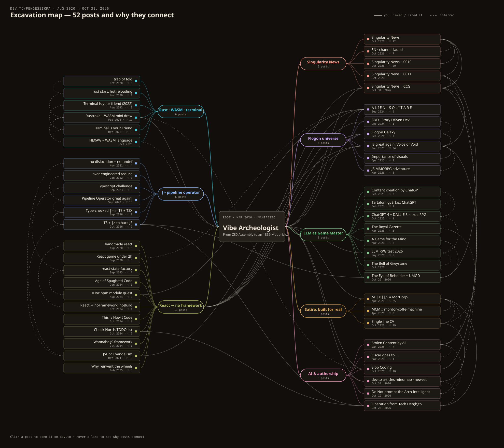

`single line CV:` Creator of [mordorjs](https://dev.to/pengeszikra/mdjs-mordorjs-1mon) and [HEXAW](https://dev.to/pengeszikra/hexaw-a-lazy-wasm-text-format-5g5n) also [pipeline-operator](https://dev.to/pengeszikra/use-this-pipe-to-feel-the-flow-483j) fanatic. 🇭🇺

mental map: `1John1 + 5John17 |> 1Moses1 = (1Moses2 ... 4.22John21); alpha & omega = !![];`

<!--
**Pengeszikra/Pengeszikra** is a ✨ _special_ ✨ repository because its `README.md` (this file) appears on your GitHub profile.

Here are some ideas to get you started:

- 🔭 I’m currently working on ...
- 🌱 I’m currently learning ...
- 👯 I’m looking to collaborate on ...
- 🤔 I’m looking for help with ...
- 💬 Ask me about ...
- 📫 How to reach me: ...
- 😄 Pronouns: ...
- ⚡ Fun fact: ...
-->

