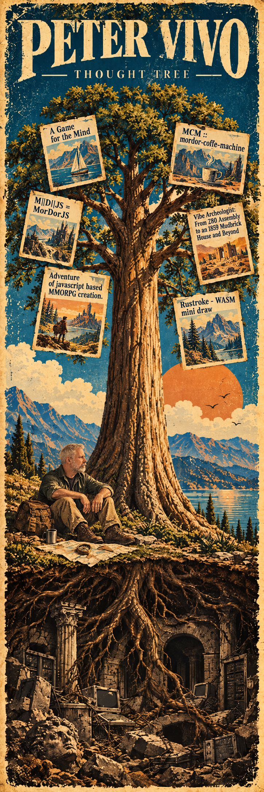

`single line CV:` Creator of [mordorjs](https://dev.to/pengeszikra/mdjs-mordorjs-1mon) and [HEXAW](https://dev.to/pengeszikra/hexaw-a-lazy-wasm-text-format-5g5n) also [pipeline-operator](https://dev.to/pengeszikra/use-this-pipe-to-feel-the-flow-483j) fanatic. 🇭🇺

mental map: `1John1 + 5John17 |> 1Moses1 = (1Moses2 ... 4.22John21); alpha & omega = !![];`

<!--
**Pengeszikra/Pengeszikra** is a ✨ _special_ ✨ repository because its `README.md` (this file) appears on your GitHub profile.

Here are some ideas to get you started:

- 🔭 I’m currently working on ...
- 🌱 I’m currently learning ...
- 👯 I’m looking to collaborate on ...
- 🤔 I’m looking for help with ...
- 💬 Ask me about ...
- 📫 How to reach me: ...
- 😄 Pronouns: ...
- ⚡ Fun fact: ...
-->

<!-- POSTMAP:START -->
<!-- Generated by scripts/postmap.mjs — edit outside this block. -->

<b>📰 Latest on dev.to</b> — the 8 newest posts, click one for the gist

 

<code>2026-10-31</code> <b>dev.to articles mindmap</b> · AI &amp; authorship

 
 
It’s hard to get used to the speed at which #KnowsEverythingBetter accelerates production beyond its... 
🧩 <a href="https://github.com/Pengeszikra/devto-post-map"><code>devto-post-map</code></a> 
3 min read · ♡ 19 · #discuss #devto #opensource #productivity 
<a href="https://dev.to/pengeszikra/devto-articles-mindmap-47j5">Read on dev.to →</a>
  

<code>2026-10-31</code> <b>Singularity News :: CCG</b> · Singularity News

 
 
This is a submission for the Hacktoberfest Open-Source AI Challenge Week 4: Ghost in the Machine ... 
🧩 <a href="https://github.com/Pengeszikra/singularity-news-ccg"><code>singularity-news-ccg</code></a> 
4 min read · ♡ 49 · #devchallenge #hf26challenge #gamedev #showdev 
<a href="https://dev.to/pengeszikra/singularity-news-ccg-5ejk">Read on dev.to →</a>
  

<code>2026-10-29</code> <b>The Eye of Beholder = UMGD</b> · LLM as Game Master

 
 
UMGD — Under Meeting Game Development game: Redneck Wreck repo:on github I owe you a... 
🧩 <a href="https://github.com/Pengeszikra/redneck-wreck"><code>redneck-wreck</code></a> 
3 min read · ♡ 14 · #ai #discuss #gamedev #showdev 
<a href="https://dev.to/pengeszikra/the-eye-of-beholder-umgd-55lm">Read on dev.to →</a>
  

<code>2026-10-28</code> <b>Liberation from Tech Dep(b)to</b> · AI &amp; authorship

 
 
Liberation I'm not talking about the length of package.json files. I run into those far... 
2 min read · ♡ 17 · #beginners #ai #discuss #tutorial 
<a href="https://dev.to/pengeszikra/liberation-from-tech-depbto-241d">Read on dev.to →</a>
  

<code>2026-10-25</code> <b>HEXAW programming language for WebAssembly instead WAT</b> · Rust · WASM · terminal

 
 
This is a submission for the Hacktoberfest Open-Source AI Challenge Week 3: Slow and Steady ... 
🧩 <a href="https://github.com/Pengeszikra/hexaw"><code>hexaw</code></a> <a href="https://www.npmjs.com/package/hexaw">📦 <code>hexaw</code></a>  · <a href="https://www.npmjs.com/package/hexaw-repository">📦 <code>hexaw-repository</code></a>  
4 min read · ♡ 48 · #devchallenge #hf26challenge #webassembly 
<a href="https://dev.to/pengeszikra/hexaw-a-lazy-wasm-text-format-5g5n">Read on dev.to →</a>
  

<code>2026-10-24</code> <b>Singularity News :: 0011</b> · Singularity News

 
Tesla Roadster always a big help! Welcome to Singularity News ... until ... well, we all know... 
3 min read · ♡ 4 · #discuss #news #ai 
<a href="https://dev.to/pengeszikra/singularity-news-0011-1ai0">Read on dev.to →</a>
  

<code>2026-10-19</code> <b>Do Not prompt the Arch Intelligent ! ! !</b> · AI &amp; authorship

 
Recently, I came across an interesting Oxford lecture by Professor Yuval Noah Harari, in which he... 
2 min read · ♡ 8 · #ai #llm #discuss #promptengineering 
<a href="https://dev.to/pengeszikra/do-not-prompt-the-arch-intelligent--2l8g">Read on dev.to →</a>
  

<code>2026-10-18</code> <b>The Bell of Greystone</b> · LLM as Game Master

 
Role-Playing Games I must confess, when I was young, I got completely hooked on... 
62 min read · ♡ 10 · #rollplaygame #showdev #llm #gamedev 
<a href="https://dev.to/pengeszikra/the-bell-of-greystone-381n">Read on dev.to →</a>
  

All posts: <a href="https://devto-post-map.vercel.app/">interactive map</a> · <a href="https://dev.to/pengeszikra">dev.to/pengeszikra</a>

<b>📦 More on npm</b> — 7 projects no post mentions yet

 

- <a href="https://github.com/Pengeszikra/3Draft"><code>3Draft</code></a> TypeScript — Minimalist AI first 3D engine <a href="https://www.npmjs.com/package/3draft">📦 <code>3draft</code></a> 
- <a href="https://github.com/Pengeszikra/marker"><code>marker</code></a> HTML · <a href="https://marker-nu.vercel.app">live ↗</a> — markdown first pure html editor web component <a href="https://www.npmjs.com/package/marker-edit">📦 <code>marker-edit</code></a>  · <a href="https://www.npmjs.com/package/marker-editor">📦 <code>marker-editor</code></a> 
- <a href="https://github.com/Pengeszikra/qwik-saga"><code>qwik-saga</code></a> TypeScript — redux-saga like process handling for qwik <a href="https://www.npmjs.com/package/qwik-saga">📦 <code>qwik-saga</code></a> 
- <a href="https://www.npmjs.com/package/typerdux">📦 <code>typerdux</code></a>  — react state handling helper based on useReducer and typescript
- <a href="https://github.com/Pengeszikra/react-slash"><code>react-slash</code></a> JavaScript — Tiny useReducer / jsx element naming oriented react helper library. <a href="https://www.npmjs.com/package/react-slash">📦 <code>react-slash</code></a>  · <a href="https://www.npmjs.com/package/preact-slash">📦 <code>preact-slash</code></a> 
- <a href="https://github.com/Pengeszikra/fencer"><code>fencer</code></a> JavaScript — experimental functional jsx framework  <a href="https://www.npmjs.com/package/fencer">📦 <code>fencer</code></a> 
- <a href="https://github.com/Pengeszikra/callbag-take-to-finally"><code>callbag-take-to-finally</code></a> fork · JavaScript — 👜 Callbag operator which emits values emitted by the source as long as each value satisfies the given predicate, and then completes as soon as predicate is not satisfied. But call lastly function before callbag is over. <a href="https://www.npmjs.com/package/callbag-take-to-finally">📦 <code>callbag-take-to-finally</code></a> 

Repos and packages that posts link are on the map above · <a href="https://www.npmjs.com/~pengeszikra">all npm packages</a> · <a href="https://github.com/Pengeszikra?tab=repositories">all repos</a>

<!-- POSTMAP:END -->

